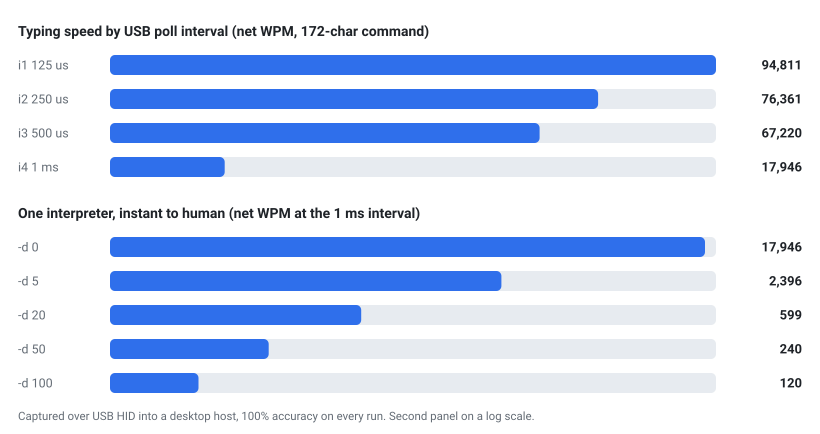

# tools

Small companions to the interpreter. Not part of the `quacky` build (`src/*.c`), so they do not
ship in the static binaries.

## qtype

A raw-terminal typing-speed meter: the console answer to a browser typing test. A browser page
re-renders on every keystroke, so it measures the browser, not the keyboard. `qtype` puts the
terminal in raw mode and just drains stdin as fast as the kernel delivers it, timing the first
byte to the last, with no echo during capture. That makes it a fair stopwatch for a USB HID
gadget typing at full tilt.

<p align="center">
  <picture>
    <source media="(prefers-color-scheme: dark)" srcset="benchmark-dark.svg">
    
  </picture>
</p>

```sh
make qtype                      # or: cc -O2 -Wall -Wextra -o tools/qtype tools/qtype.c
./tools/qtype passage.txt       # interactive: dim hint, your typing overlaid, live stats
./tools/qtype --bench passage.txt   # no echo, no drawing: the raw ceiling
```

Two modes. The default is an interactive view, like MonkeyType: the passage shows as a dim hint,
typed characters overlay it (correct in normal weight, wrong in red on the expected glyph), a
caret marks the position, and a header shows live wpm / accuracy / elapsed / progress. Because it
redraws each frame, its number includes the cost of drawing, so use `--bench` for the fair
ceiling: that mode captures with no echo and no rendering, timing only how fast the bytes arrive.

Either way it waits for input, and when typing stops (the passage is complete, or input idles)
it prints characters read, accuracy against the target, elapsed time, chars/sec, and net/raw WPM.
Feed the same text to Quacky (`type <the passage>\c` on one line) over `--hid`, focus the
terminal, and read the number.

Measured with `--bench` on a phone over USB HID into a Fedora host: 5490 WPM at the default
rollover-off typing, 9704 WPM with `--fast`, both at 100% accuracy. A browser capped at ~2444 on
the same run, which is what prompted this tool.

Chasing that further turned into a hardware story. The ~1 ms USB poll was the wall, so the
companion USB Arsenal project got a kernel patch to lower the HID endpoint's `bInterval`. Typing
816 characters with `--fast` at each poll interval (same phone, same host) measured:

| poll interval | chars/sec | net WPM | accuracy |
|---|---|---|---|
| 1 ms (stock)  |    884 |  10,604 | 100% |
| 500 us        |  2,377 |  28,524 | 100% |
| 250 us        |  6,640 |  79,681 | 100% |
| 125 us        | 11,207 | 134,489 | 100% |

12.7x from the stock interval, still 100% correct. The one thing that ever broke was the host's
terminal emulator, which crashed when fed ~11k keystrokes a second for half a second. The ceiling
is the receiving computer, not the gadget. Use `--bench`, not the interactive view, for numbers
like these: drawing each frame would make the terminal, not the keyboard, the thing you measure.
